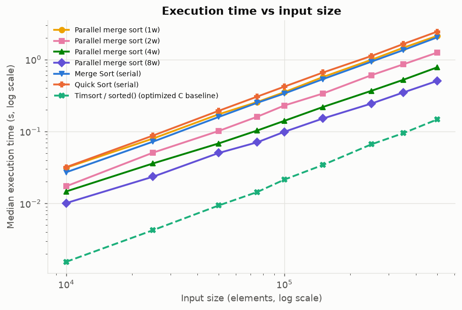
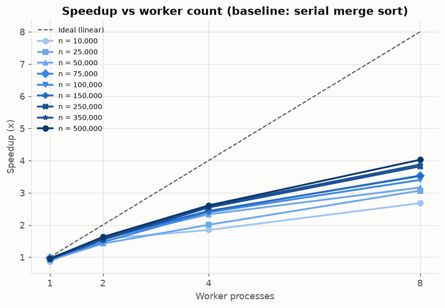
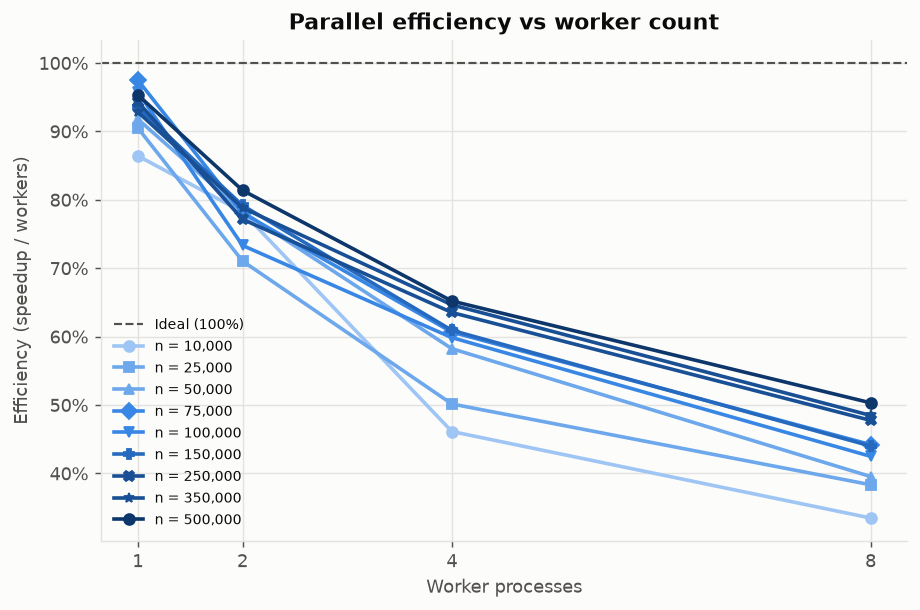
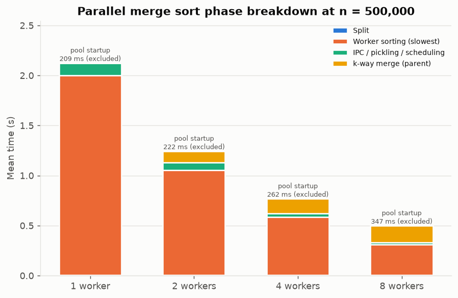
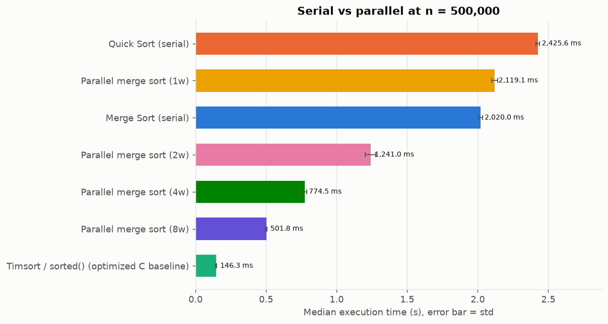
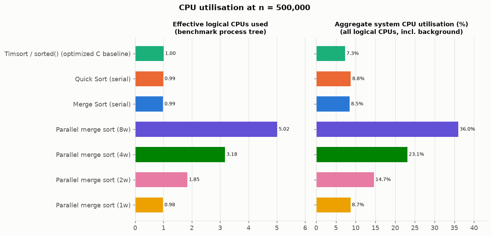
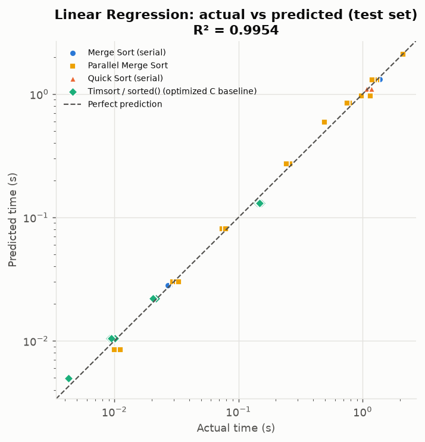
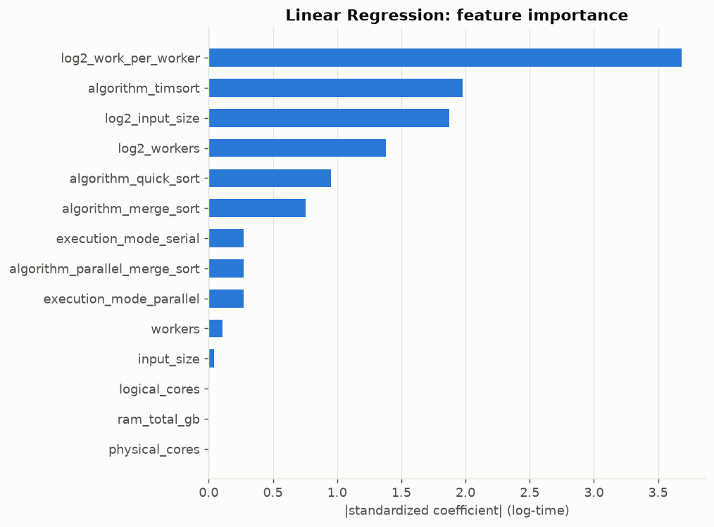

# Multicore AI Performance Prediction

**Machine learning-based performance analysis and execution-time prediction of serial and parallel sorting algorithms on multicore processors.**

This project benchmarks serial and parallel sorting algorithms on a real multicore CPU, analyses their scalability (speedup, efficiency, overheads, load balance), and trains machine-learning regression models that predict an algorithm's execution time from the input size, worker count and hardware. Everything is accessible through a command-line interface and an interactive Streamlit dashboard.

   

---

## Table of contents

1. [Objectives](#objectives)
2. [Project structure](#project-structure)
3. [Algorithms](#algorithms)
4. [Benchmarking methodology](#benchmarking-methodology)
5. [Machine-learning models](#machine-learning-models)
6. [Results](#results)
7. [Installation](#installation)
8. [Usage](#usage)
9. [Testing](#testing)
10. [Limitations](#limitations)

---

## Objectives

- Implement classic **serial** sorting algorithms and a **parallel** merge sort that uses multiple CPU cores.
- Build a **reproducible benchmarking engine** that measures execution time, CPU utilisation, startup/communication/merge overheads and load imbalance, and verifies correctness of every run.
- Quantify **speedup** and **parallel efficiency** across input sizes and worker counts, and explain where scalability is lost (Amdahl's law, IPC cost, serial merge phase).
- Train and compare **ML regression models** (Linear Regression, Decision Tree, Random Forest) that predict execution time, using leakage-free validation.
- Provide an **interactive dashboard** to run experiments, explore results and make predictions.

## Project structure

```
.
├── algorithms/
│   ├── serial_sort.py        # merge sort, quick sort, Timsort wrapper
│   └── parallel_sort.py      # parallel merge sort on a persistent multiprocessing pool
├── benchmarking/
│   ├── benchmark.py          # dataset generation, timed runs, correctness checks, CSV output
│   ├── metrics.py            # speedup, efficiency, summary statistics, automatic insights
│   └── system_monitor.py     # hardware info and CPU-usage sampling (psutil)
├── ml/
│   ├── preprocessing.py      # feature engineering + ColumnTransformer
│   ├── train.py              # training, GroupKFold CV, held-out test, model persistence
│   ├── evaluate.py           # regression metrics, feature importance, extrapolation check
│   └── predict.py            # prediction with range warnings and historical comparison
├── dashboard/
│   ├── components.py         # Streamlit UI building blocks
│   └── visualizations.py     # Matplotlib figures
├── data/
│   ├── raw/benchmark_results.csv        # 315 raw measurements
│   └── processed/benchmark_summary.csv  # 63 aggregated configurations
├── models/                   # trained pipelines (.joblib) + model_metadata.json
├── results/
│   ├── model_metrics.csv, test_predictions.csv, feature_importance.csv
│   ├── performance_insights.json, benchmark_log.txt
│   └── plots/                # generated graphs
├── tests/                    # pytest suite
├── app.py                    # Streamlit dashboard
├── main.py                   # CLI entry point
├── config.py                 # paths, defaults, algorithm registry
└── requirements.txt
```

## Algorithms

| Algorithm | Mode | Implementation notes |
|---|---|---|
| **Merge Sort** | Serial | Top-down recursive, stable, O(n log n). Baseline for speedup. |
| **Quick Sort** | Serial | Iterative, seeded random pivot, Dijkstra 3-way partitioning (handles duplicates), O(log n) stack. |
| **Timsort** | Serial | Python's built-in `sorted()` (C implementation) — an optimised reference baseline. |
| **Parallel Merge Sort** | Parallel | Input split into balanced contiguous chunks → each worker process sorts its chunk with serial merge sort → parent performs an O(n log k) k-way merge (`heapq.merge`). Uses a persistent `multiprocessing` pool whose startup cost is measured separately. |

## Benchmarking methodology

- **Grid:** input sizes 10,000 – 500,000 (9 sizes) × worker counts {1, 2, 4, 8} × 5 repetitions → **315 measurements, 63 configurations**.
- **Data:** reproducible random integers in [-1,000,000, 1,000,000] (negatives and duplicates included), fixed seed `42`.
- **Fairness:** randomized execution order, an untimed warm-up of each configuration before every timed run (prevents core-parking / clock-ramp bias), garbage collection controlled around timing.
- **Correctness:** every output is checked against `sorted(data)`; a mismatch aborts the benchmark.
- **Timing:** `time.perf_counter()`; for parallel runs the split, parallel-compute, merge and communication (pickling/IPC) phases are timed separately, as is process-pool startup.
- **System metrics** (psutil): machine-wide CPU %, process CPU time and effective cores used, plus CPU model, physical/logical cores, RAM, OS and Python version.
- **Derived metrics:**
  - Speedup = T(serial merge sort) / T(parallel merge sort) — compared within the same algorithm family only.
  - Efficiency = Speedup / workers.
  - Load imbalance = max / mean worker compute time.

Test hardware: **AMD Ryzen 7 7735U** (8 cores / 16 threads), 15.2 GB RAM, Windows 11, Python 3.13.7.

## Machine-learning models

- **Target:** execution time (seconds). Models learn `log(time)` internally via `TransformedTargetRegressor`, because times span several orders of magnitude; all metrics are reported in seconds.
- **Features:** `input_size`, `workers`, `physical_cores`, `logical_cores`, `ram_total_gb`, complexity-aware features `log2_input_size`, `log2_workers`, `log2_work_per_worker`, and one-hot encoded `algorithm` and `execution_mode`.
- **Models:** Linear Regression, Decision Tree Regressor, Random Forest Regressor (300 trees).
- **Leakage-free validation:** the test set is a `GroupShuffleSplit` over *configurations* (algorithm, workers, size) — no repetition of a test configuration is seen during training. Model selection uses `GroupKFold` cross-validation on the training portion, ranked by RMSE.
- **Extrapolation check:** a separate experiment trains on sizes ≤ 350,000 and tests on the unseen size 500,000.
- **Metrics:** MAE, MSE, RMSE, R², MAPE.

## Results

### Parallel scalability (n = 500,000)

| Workers | Median time (s) | Speedup vs serial merge sort | Efficiency |
|---:|---:|---:|---:|
| Serial merge sort | 2.020 | 1.00× | – |
| 1 | 2.119 | 0.95× | 95% |
| 2 | 1.241 | 1.63× | 81% |
| 4 | 0.775 | 2.61× | 65% |
| 8 | 0.502 | **4.03×** | 50% |

Reference points at the same size: serial Quick Sort 2.426 s, built-in Timsort 0.146 s.

**Key findings**

- Parallel merge sort reaches a **4.03× speedup with 8 workers** at n = 500,000, but efficiency drops from 95% to 50% as workers increase.
- The **final k-way merge in the parent is serial** and takes ~15% of parallel execution time at the largest size; IPC/pickling adds ~5%. Both limit scalability, consistent with Amdahl's law.
- **Process-pool startup** costs 220–351 ms (1–8 workers). Including it, serial merge sort beats a one-off parallel sort for n ≤ 100,000.
- With 1 worker the parallel version is ~7.5% slower than serial merge sort — the pure overhead of moving data to a worker process.
- Load balance is good (max/mean worker time ≤ 1.10); residual imbalance comes from OS scheduling/SMT, not uneven chunks.
- Python's **C-implemented Timsort beats the pure-Python parallel sort at every size** — implementation efficiency outweighs multicore parallelism here.

### Model performance

| Model | CV RMSE (s) | Test RMSE (s) | Test R² | Test MAPE |
|---|---:|---:|---:|---:|
| **Linear Regression** (selected) | **0.0215** | **0.0431** | **0.995** | **7.9%** |
| Random Forest | 0.1085 | 0.1357 | 0.954 | 32.7% |
| Decision Tree | 0.1830 | 0.1570 | 0.938 | 30.0% |

On the extrapolation check (train ≤ 350k, test on 500k), Linear Regression keeps **R² = 0.993 and MAPE = 7.5%**. The log-time linear model fits well because sorting time follows a near power law in `n / workers` (empirical growth exponents ≈ 1.0–1.17), which tree models cannot extrapolate beyond the training range. The most important feature is `log2_work_per_worker`.

### Graphs

| | |
|---|---|
|  |  |
|  |  |
|  |  |
|  |  |

More plots (Decision Tree and Random Forest diagnostics) are in [`results/plots/`](results/plots/).

## Installation

Requires **Python 3.13** (tested on 3.13.7, Windows 11).

```bash
git clone https://github.com/tushi145/multicore-ai-performance-prediction.git
cd multicore-ai-performance-prediction

python -m venv .venv
# Windows
.venv\Scripts\activate
# macOS / Linux
source .venv/bin/activate

pip install -r requirements.txt
```

## Usage

The repository already contains the benchmark dataset, trained models and results, so you can go straight to prediction or the dashboard. Re-running the benchmark will append new measurements from your own machine.

### Command line

```bash
# Run the full benchmark grid (appends to data/raw/benchmark_results.csv)
python main.py benchmark --sizes 10000 50000 100000 250000 500000 --workers 1 2 4 8 --reps 5

# Summary statistics, insights and plots
python main.py analyze

# Train, validate and save the ML models
python main.py train

# Predict execution time
python main.py predict --size 300000 --algorithm parallel_merge_sort --mode parallel --workers 4
python main.py predict --size 200000 --algorithm quick_sort --mode serial

# Run one benchmark
python main.py single --algorithm parallel_merge_sort --size 100000 --workers 8

# Benchmark -> analyze -> train in one go
python main.py all
```

Algorithms: `merge_sort`, `quick_sort`, `timsort`, `parallel_merge_sort`.

### Dashboard

```bash
streamlit run app.py
```

Sections: **System Overview**, **Run Experiments**, **Performance Comparison**, **Machine Learning**, **Execution Time Prediction**, **Dataset & Results** (with downloads).

> **Windows note:** parallel sorting uses the `spawn` start method, so any script that creates the pool must be guarded by `if __name__ == "__main__":` (already done in `main.py`).

## Testing

```bash
pytest
```

The suite covers sorting correctness, parallel chunking/merging, the benchmarking engine, the ML pipeline and dashboard figures.

## Limitations

- All measurements come from a **single machine**, so hardware features are constant in the training data; predictions for other hardware are not validated.
- Sorts are implemented in pure Python (except the Timsort baseline), so absolute times reflect interpreter overhead.
- Predictions outside the benchmarked input-size / worker range are extrapolations and are flagged with a warning.
